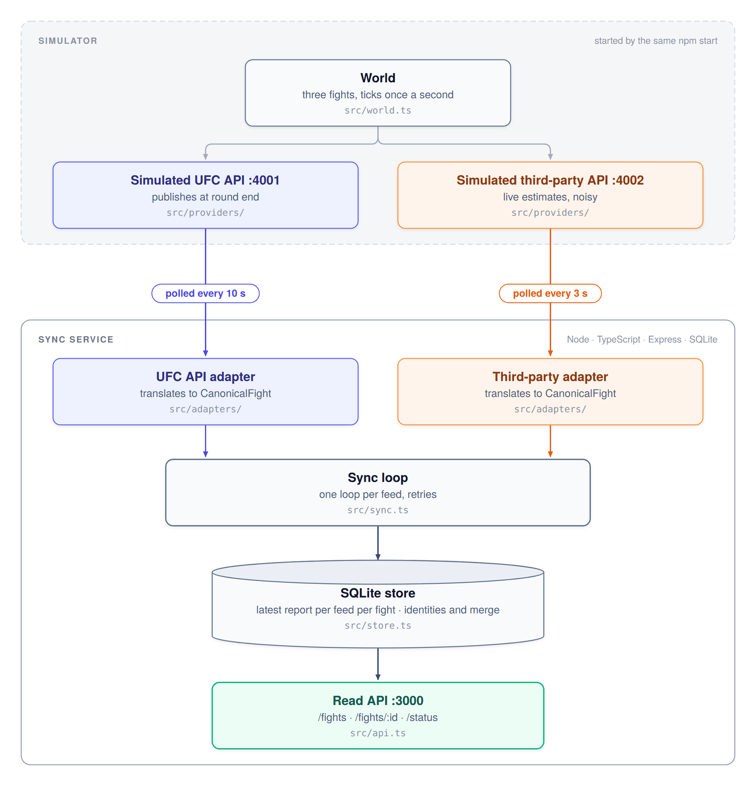

# External Data Sync Engine

Two simulated feeds report on the same UFC card in different formats and at different speeds. The **UFC API** represents an official data stream of the UFC and only publishes when a round ends. The **third-party API** represents a computer-vision model that estimates the stats and numbers live, with noise. This service polls both upstream sources, translates each into one shared shape, merges them round by round with one rule, and serves the result over HTTP with the source of every number and how fresh each feed is. If a feed stops answering, the API keeps serving the last good data and says how old it is.

Built with Node, TypeScript, Express and SQLite. One command starts everything.

## Run it

You need Node 24 or newer.

```bash
npm ci            # install dependencies
npm run check     # typecheck and run tests
npm start         # the simulated feeds (4001, 4002), the synchronization loop, and the API (3000)
```

Optional: pick how the feeds behave with the `--scenario` flag:

```bash
npm start -- --scenario ufc-api-down
```

| Scenario | What happens |
| --- | --- |
| `flaky` (default) | The UFC API allows 20 requests a minute and answers 429 past that. The third-party API repeats itself, adds noise, breaks one stat, and answers slowly every 13th call |
| `calm` | No faults. Both feeds just work |
| `ufc-api-down` | The UFC API works through round 1 of fight 1, then 30 seconds into round 2 every call hangs until the 2 s timeout |
| `third-party-api-down` | Same timing, for the third-party API |
| `both-down` | Both go dark 30 seconds into round 2. The API keeps serving the last good data, marked stale |
| `ufc-api-lagging` | The UFC API answers every poll but publishes every change a minute late. A round stays the third-party estimate for a minute after it ends, then the UFC numbers replace it |
| `ufc-api-late-start` | The UFC API is dark until 40 seconds after fight 2 starts. Fight 2 first exists only from the third-party API, under a provisional id, and is linked to the UFC API's fight 2 when it appears |

State lives in `sync.db` next to `package.json`; delete it to start clean. The card is over in under ten minutes; restart to replay it.

## Try it

```bash
curl localhost:3000/fights             # every fight on the card, plus freshness per feed
curl localhost:3000/fights/fight-2     # one fight
curl localhost:3000/fights/fight-9     # not synced yet: 404 with fight: null and a reason
curl localhost:3000/status             # is each feed healthy, stale, or failing?
curl localhost:4001/v1/fights          # the raw UFC API, for comparison
curl localhost:4002/feed               # the raw third-party API
```

## What is simulated

A simulated Saturday fight card of three scripted fights, moving at 5x speed, where the UFC API is polled every 10 seconds and the third-party API every 3 seconds. For each fighter in each round, the world counts stats like significant strikes, takedowns, knockdowns, and control time.

## Upstream problems and how the service handles them

- **Retries & Rate Limiting:** A poll gets up to 3 tries using exponential backoff with full jitter (up to 200ms, then 400ms) so clients do not retry together. Only timeouts, 429s, and 5xx errors are retried. If a `429` `Retry-After` header asks for more than 5 seconds, the poll aborts and retries on the next cycle.
- **Outages & Latency:** Feeds that hang hit a 2-second timeout per try. If a poll completely fails, the API continues serving the last known good data (marked `stale` after 30 seconds) without blocking the other feed.
- **Broken Stats:** If the third-party API sends an invalid stat (e.g., takedowns as `"n/a"`), that specific stat is dropped and counted. The rest of the valid frame is still processed.
- **Unknown Entities:** If the third-party camera detects a fight before the UFC API reports it, it is served under a provisional ID and seamlessly merged once the official data arrives.
- **Repeats:** Both feeds frequently re-send identical data. These are counted as `unchanged` with no new records stored, though the feed's freshness metric is still updated.
- **Different Schemas and IDs:** The feeds use fundamentally different formats (e.g., Unix seconds vs. ISO times, different fight IDs). One adapter per feed translates these into a shared `CanonicalFight` model. The store matches unknown bout names through an identity table.

## How it works



One record's journey: the sync loop asks a feed for everything it has, the adapter translates each item into `CanonicalFight`, the store keeps it if it is newer than that feed's previous report, and the API serves the two feeds' reports merged round by round.

### Code files

- **World** (`src/world.ts`) is the simulated card. It moves forward once a second. Only the simulated feeds read it.
- **Simulated feeds** (`src/providers/`) are two small Express servers that report the world in their own formats and at their own pace. `--scenario` (`src/scenario.ts`) picks their faults.
- **Adapters** (`src/adapters/`) are the only code that knows a feed's format. Each one fetches and translates to `CanonicalFight`. What they share, fetching JSON and trying one record or one stat at a time, lives in `shared.ts`. Anything the adapter cannot read is rejected as bad data.
- **Sync loop** (`src/sync.ts`) runs one loop per feed on its own schedule, with a 2 second timeout per call and up to three tries per poll (`src/retry.ts`). A failure is recorded and never thrown, so one feed failing never blocks the other.
- **Store** (`src/store.ts`) is SQLite: an append-only log of every translated report, the latest report from each feed per fight, per-feed health, and the identities table. It calls two pure modules: the merge rule (`src/merge.ts`) and identity matching (`src/identity.ts`).
- **API** (`src/api.ts`) reads the store and never calls a feed. Route handlers have no logic of their own.
- **Shared shapes** (`src/types.ts`): the canonical model and two helpers for adding up stats.

### Which feed wins

The system uses two different clocks to resolve conflicts: **Fight time** (where we are in the actual fight) and **Wall time** (the feed's own timestamp, and when we received it).

- **Fight time decides who owns the data:** The official UFC API owns every round it has fully published. The third-party API owns the round currently in progress. Inside any given round, if the UFC API has a stat, we use it; otherwise, we use the third-party estimate, and if neither has it, the value is `null`, never a made-up zero.
- **Handling late data:** Because we merge based on *fight time*, if the official round 2 numbers arrive while the third-party camera is already broadcasting round 3, we don't throw the official numbers away just because they arrived "late."
- **Wall time decides the order of updates:** If a feed sends us duplicate data, or data older than what we already have from that same feed, we simply ignore it. This ensures rounds never move backward.
- **Wall time decides staleness:** If no feed has sent an update for a fight in 30 seconds, it is flagged as `stale`. 
- **Official match status and final result** come from the UFC API only. The third-party API cannot know them and is never allowed to write them.
## Entity resolution

The UFC API uses our ids. The third-party API names a bout its own way (`main-card-2`) and its fighters by corner, with a first name, last name and age. The store decides who they are, from an `identities` table, in this order:

1. **Configured.** Bouts we were told about up front: `main-card-1` and `prelim-1`.
2. **Matched.** Both corners agree on first name, last name and age with one fight the UFC API has reported. Two candidate fights is no match, because guessing is worse than waiting. `main-card-2` is left unconfigured on purpose, so it is always matched at runtime.
3. **Provisional.** No match yet, so the fight is served under the camera's own id, `tp:main-card-2`, flagged `identity: "provisional"`. When the UFC API reports those two fighters, the report is moved under the real ids in one step. Nothing is lost and nothing is duplicated.

The `ufc-api-late-start` scenario shows all three.

## Observability

- **Stdout:** Logs one summary line per poll detailing fetched, updated, and unchanged records.
- **`/status` endpoint:** Exposes per-feed health, staleness, current failure streaks, and lifecycle counters (polls, retries, rejected records).

Every run writes five plain-text files under `logs/` (one JSON object per line):
- `sync.log`: Polling activity, retries, and rejected stats.
- `updates.log`: Every state change written to the store, in order.
- `api.log`: HTTP requests to the read API.
- `world.log`: Ground truth events (fight starts, round ends) for the simulated card.
- `errors.log`: A filtered view of all system errors.

```bash
tail -f logs/sync.log                                        # watch the loop
tail -f logs/updates.log                                     # every write to the store, as it happens
grep fight-1 logs/updates.log | jq -c '{feed, round, numbers}'  # how fight 1 changed, report by report
grep fight_ended logs/world.log | jq -c .result              # how each fight really ended
sqlite3 sync.db "select source, event_time, received_at from observations"   # what each feed last said, per fight
sqlite3 sync.db "select source, datetime(received_at/1000,'unixepoch') as at, substr(report,1,80) from translated_reports order by id desc limit 10"   # the last ten reports as they arrived
```

## Trade-offs

- **Polling instead of push:** A round end reaches the store up to 10 seconds late, but this keeps the simulated feeds small and simple.
- **Live rounds are estimates:** The live round is just an estimate until the official UFC API settles it. Waiting for the official numbers would put the API a full minute behind the actual fight.
- **SQLite with one writer:** This database choice is perfectly fine for running a single process on a laptop. The "at scale" note below explains what would replace it in a larger environment.
- **Guessing identities:** Identity matching is an educated guess based on a fighter's first name, last name, and age. A real system would use an official roster to know exactly who everyone is.
- **Temporary IDs:** Unmatched fights show the camera's temporary IDs (like `tp:main-card-2`) until they link up with the official data. Anyone using this API has to be ready to update that ID in their own system when the official one arrives.
- **Mixed stats in one round:** Filling a missing stat from the other feed can mix data sources in a single round. Because of this, significant strikes might occasionally look higher than total strikes. We keep the source visible on every single number so it is clear why this happens, which is much better than throwing away a whole round of good data just because one stat was missing.

## If this had to run at real scale

- **Separate fetching from applying:** Right now, the loop does everything. At scale, one worker per feed would just fetch data and drop it into a queue, while a separate worker processes that queue. This ensures a slow feed can never slow down the rest of the system.
- **Move away from SQLite:** SQLite is great for a single process, but at scale, you would have multiple API servers reading the data at once. You would swap SQLite out for a shared database like Postgres or MongoDB so all servers read from the exact same state.
- **Alerts for stale data:** The `ageSeconds` metric would be hooked up to a real monitoring system. In a live sports app, stale data is the most critical failure, so an alert would fire if that number gets too high.
- **Adding more providers:** Adding a second computer-vision feed would just require writing one new adapter. To handle the data merging, the simple "official vs. estimate" rule would simply upgrade into a priority list (e.g., UFC API > Vendor A > Vendor B).

## AI and tools

I planned the design and architecture diagram in conversation with Claude, and implemented it using Claude Code in VS Code, carefully reviewing every change before keeping it. 

One place where I explicitly overruled the AI was when it wanted to throw out an entire fight record if just one field was missing or unreadable. I rejected that approach because one bad stat does not make the fighter names, the round, the clock, or the other valid stats wrong. I thought about this like sports betting player props. If one specific market goes unavailable, the rest of the board should stay up. Because of this, a bad stat is simply dropped and counted, but the rest of the valid record is still used. A great next step for this system would be re-polling the source for just the affected fight when a field comes back wrong, rather than re-polling everything.
